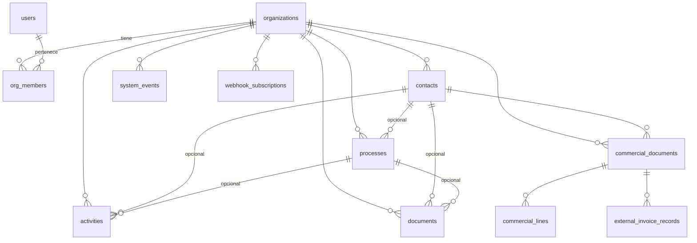

# Modelo de datos — platform (fase 0)

**Promesa:** [doc 23](../../docs/23-ecosistema-impersia-cloud.md)  
**SQL:** [../services/api/migrations/001_core.sql](../services/api/migrations/001_core.sql)  
**Decisión facturación:** borrador + export; no factura legal emitida en v1.

Todo vive en el esquema PostgreSQL **`platform`**, separado del OS legacy.

---

## Vista general

---

## Cuenta y organización (A1)

| Tabla | Uso |
|-------|-----|
| `users` | Persona que entra (email + hash). |
| `organizations` | Autónomo o micro-pyme (nombre, NIF/CIF opcional). |
| `org_members` | Quién puede ver/editar qué org (`owner` / `admin` / `member`). |

Toda fila de negocio lleva `org_id` para filtrar por tenant.

---

## Escritorio (A2–A6)

| Tabla | Bloque | Uso |
|-------|--------|-----|
| `contacts` | A3 | Clientes/proveedores: nombre, NIF, email, teléfono, notas. `archived_at` para ocultar sin borrar. |
| `processes` | A4 | Oportunidad, encargo o proceso ligero: título, estado, contacto opcional, responsable, fecha límite. |
| `activities` | A4, A5 | Tareas, llamadas, reuniones, notas de seguimiento. `due_at` (pendientes), `start_at`/`end_at` (agenda). Enlaces opcionales a contacto y proceso. |
| `documents` | A6 | Metadatos de fichero (`storage_key`, nombre, MIME, tamaño) ligados a contacto y/o proceso. |

**Panel (A2):** consultas sobre `activities` (pendientes, vencidos, próximas con `start_at`) + actividad reciente por `created_at` / `system_events`.

---

## Canales (B) — preparado, mínimo en fase 0

| Tabla | Uso |
|-------|-----|
| `channel_entries` | Registro manual o importado (correo/WhatsApp/otro): texto, contacto opcional, fecha del mensaje. La API de integración llega en fase 2; el modelo ya permite historial unificado en la ficha del contacto. |

---

## Automatización (C)

| Tabla | Uso |
|-------|-----|
| `system_events` | Hecho ocurrido (`contact.created`, `activity.completed`, `commercial.exported`, …) con `payload` JSON para n8n/webhooks. |
| `webhook_subscriptions` | URL + secreto + filtro de tipos de evento por organización. |

---

## Facturación puente (D)

| Tabla | Uso |
|-------|-----|
| `commercial_documents` | Presupuesto / proforma / borrador comercial (`quote`, `proforma`, `order`). Importes totales; estado hasta `exported`. |
| `commercial_lines` | Líneas: concepto, cantidad, precio, IVA %. |
| `external_invoice_records` | **Facturado fuera:** sistema (Holded, gestoría, …), referencia, URL, fecha, enlace al borrador o contacto. |

No hay tabla de “factura legal emitida por Impersia” en v1.

---

## Convenciones

- **IDs:** `uuid`, generados en servidor.
- **Borrado:** preferir `archived_at` en contactos; `ON DELETE CASCADE` donde el hijo no tiene sentido sin padre (líneas comerciales).
- **Moneda:** EUR por defecto en documentos comerciales.
- **Eventos:** insertar en `system_events` desde la API al cambiar entidades relevantes (implementación fase 3).

---

## Mapa fases → tablas

| Fase doc 23 | Tablas principales |
|-------------|-------------------|
| 0 (este doc) | Todas las anteriores |
| 1 Escritorio | contacts, processes, activities, documents |
| 2 Canales | channel_entries + API entrada única |
| 3 Automatización | system_events, webhook_subscriptions |
| 4 Facturación D | commercial_*, external_invoice_records |

---

*27 octubre 2026 — acordado con Modesto (export facturación).*
